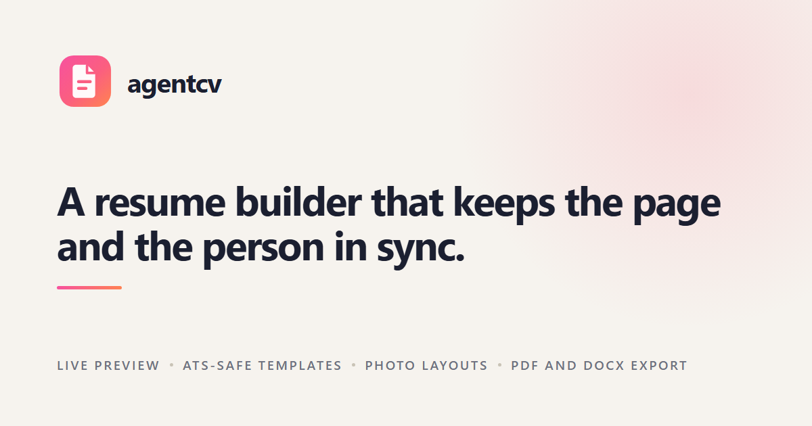

# AgentCV

[](https://github.com/nkswalih/AgentCV/actions/workflows/ci.yml)
[](LICENSE)

A local-first resume builder with a live editor, distinct templates, structured resume import, and PDF, DOCX, and LaTeX export.



## Highlights

- **17 distinct templates**, including ATS-oriented, technical, editorial, sidebar, and photo layouts
- **Structured resume import** from PDF, DOCX, TXT, and LaTeX, with a review step before anything is saved
- **Live editing and design controls** for sections, typography, spacing, colors, columns, links, and photos
- **PDF, DOCX, and LaTeX export** from the same document model
- **Local storage by default** using SQLite; resume files uploaded for import are parsed in memory
- **No account or cloud service required**

## Tech stack

- React 19, TypeScript, Vite, Zustand, and dnd-kit
- FastAPI, Pydantic, SQLAlchemy, and SQLite
- Playwright/Chromium for print-accurate PDF rendering
- pypdf for PDF text and link-annotation recovery

## Quick start

### Requirements

- Python 3.11 or newer
- Node.js 20 or newer
- npm 10 or newer

### Install and run

```bash
git clone https://github.com/nkswalih/AgentCV.git
cd AgentCV

python -m venv backend/.venv

# macOS/Linux
source backend/.venv/bin/activate
# Windows PowerShell
# backend\.venv\Scripts\Activate.ps1

python -m pip install --upgrade pip
python -m pip install -r backend/requirements.txt
python -m playwright install chromium

cd frontend
npm ci
npm run build
cd ../backend

python -m uvicorn app.main:app --host 127.0.0.1 --port 8000
```

Open <http://127.0.0.1:8000>.

### Development mode

Run the API and Vite server in separate terminals:

```bash
# Terminal 1, from backend/
python -m uvicorn app.main:app --reload --port 8000

# Terminal 2, from frontend/
npm run dev
```

Open <http://localhost:5173>. Vite proxies API and uploaded-image requests to the backend.

## Data and privacy

AgentCV is designed as a single-user local application.

- Resume data is stored in `backend/data/agentcv.db`.
- Uploaded profile images are stored in `backend/uploads/`.
- Imported resume bytes are parsed in memory and are not written to disk.
- The database, uploads, exported resumes, credentials, and local environment files are excluded by `.gitignore`.

Back up `backend/data/` and `backend/uploads/` if you need to preserve your local documents. **Do not expose the FastAPI server directly to an untrusted network:** this version intentionally has no authentication or multi-user authorization.

## Import behavior

Import is intentionally review-first. AgentCV extracts a structured draft and lets you correct it before creating or replacing a document. PDF extraction can recover HTTP links stored only as clickable annotations, such as project labels that display “GitHub” or “Live” without printing the URL.

Resume parsers are heuristic by nature. Complex tables, scanned PDFs without a text layer, and unusual visual reading orders may still need manual correction in the review screen.

## Verification

```bash
# Frontend typecheck and production bundle
cd frontend
npm run build

# Backend unit tests, from the repository root
python -m unittest discover -s backend/tests -v
```

The scripts in `frontend/e2e/` provide additional browser checks. Start both development servers before running them; generated screenshots and metrics are written to the ignored `frontend/e2e/artifacts/` directory.

## Project layout

```text
backend/
  app/                 FastAPI API, persistence, import, and export
  tests/               Backend unit tests
frontend/
  src/components/      Dashboard and creation/import dialogs
  src/editor/          Resume editor and preview
  src/templates/       Template registry and renderers
  e2e/                 Browser-based verification scripts
```

## Contributing

Contributions are welcome. Read [CONTRIBUTING.md](CONTRIBUTING.md) before opening a pull request. For security issues, follow [SECURITY.md](SECURITY.md) instead of creating a public issue.

## License

AgentCV is available under the [MIT License](LICENSE).
